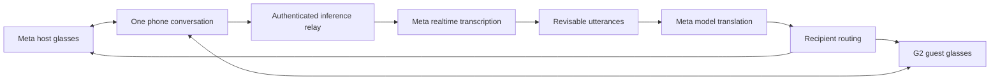

# Proposed demo and execution plan

Status: superseded topology. The current one-phone target and execution gates are in [ONE-PHONE-EXECUTION.md](ONE-PHONE-EXECUTION.md). Browser rehearsal exists; physical validation is pending.

## The experience

Two people join one conversation, select English and Mandarin, explicitly consent to remote processing, and receive the other person's translated speech. Show the original on demand, distinguish provisional from final text, and make stop/disconnect visible. Choose simplified or traditional Chinese explicitly. Start with one concrete conversation such as a visitor asking a local guide questions.

Meta already offers consumer translation features. Our proposed distinction is a shared session with recipient-specific language/output, clear source provenance, corrections, and reusable transcript/media contracts. Do not pitch generic translation on glasses as novel.

## Composition

Use one phone driving the Meta host and G2 guest; no second phone is part of the product target. This is an implementation hypothesis, not proof of simultaneous device support. The glasses SDK handles capture/output; model APIs handle inference. Keep long-lived provider credentials on the authenticated relay. Use short-lived application join tokens, bounded buffers and no default audio recording.

A microphone source ID is not a speaker identity. Both microphones may hear the same person. Independent diarization sessions do not share speaker identities; loudness and language alone are insufficient. Begin with explicit turn control in a controlled, consented setting. Preserve source provenance and test cross-talk before adding automatic attribution. Upload filtering would need independent local validation before claiming bystander audio never leaves the device.

Normalize transcript revisions and finality before translating. Key updates by session epoch and utterance ID so reconnections cannot overwrite older turns. Translate stable segments first; excessive partial translation causes flicker and higher cost. Stop/revocation must terminate capture, queued uploads and presentation on both endpoints. Show gaps rather than fabricating continuity.

Use output capabilities, not model-brand conditionals: phone text, supported glasses display, or separately implemented audio output. Ordinary Ray-Ban Meta glasses must not be assumed to have a text display. G2 can remain another adapter without changing session contracts. Audit the actual available hardware before committing the demo format.

## Bounded sequence

1. Access and feasibility: confirm actual API entitlement/credits, English/Mandarin recognition, translation and latency. Exercise exact glasses capture/output APIs on physical hardware.
2. Vertical slice: one phone owns the session, routes typed and then spoken turns correctly, display original/translation and stop together.
3. Glasses integration: reuse suitable Ghost Runner lifecycle/capture/presentation components after checking pinned versions. Do not transplant app-wide keepalive or the Cat shell.
4. Robustness: test cross-talk, code switching, reconnection, revocation, silence and interrupted turns. Measure latency and cost.
5. Presentation: record a truthful short demo, disclose inherited components and event work, prepare submission with a full day of margin if feasible.

Keep screen translation, PiP, full CatCut integration and automatic voiceprint enrollment outside the minimum demonstration. Reuse common contracts so these remain possible later. These estimates depend on access and hardware; they are not promises of delivery.

## Acceptance evidence

- At least 20 consented bilingual turns with no recipient routing errors; include numbers, names, negation and code switching.
- Report p50/p95 end-of-speech-to-readable-translation latency, sample size, network conditions and errors. A target is not a measurement.
- A 30-minute physical-device session with explicit disconnect/rejoin and stop tests.
- No stale translation delivered after revocation or to a previous session participant.
- No provider secrets in clients or logs; no default audio/transcript persistence.
- Separate phone proof, glasses proof and any simulation in the demo report.

Before submission, verify authenticated event requirements. The participant details page has not yet been accessible in the available browser.
